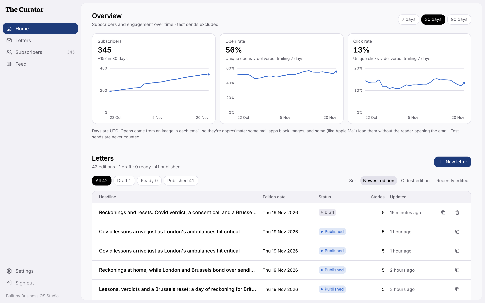
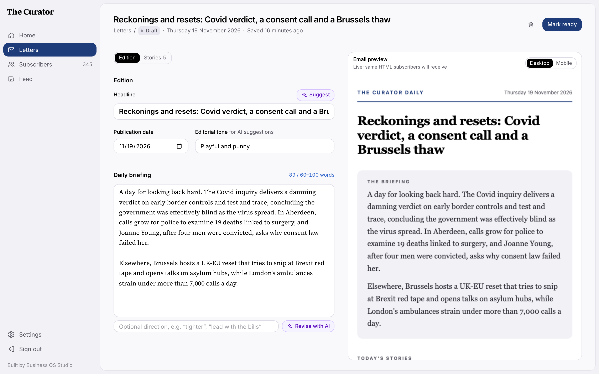
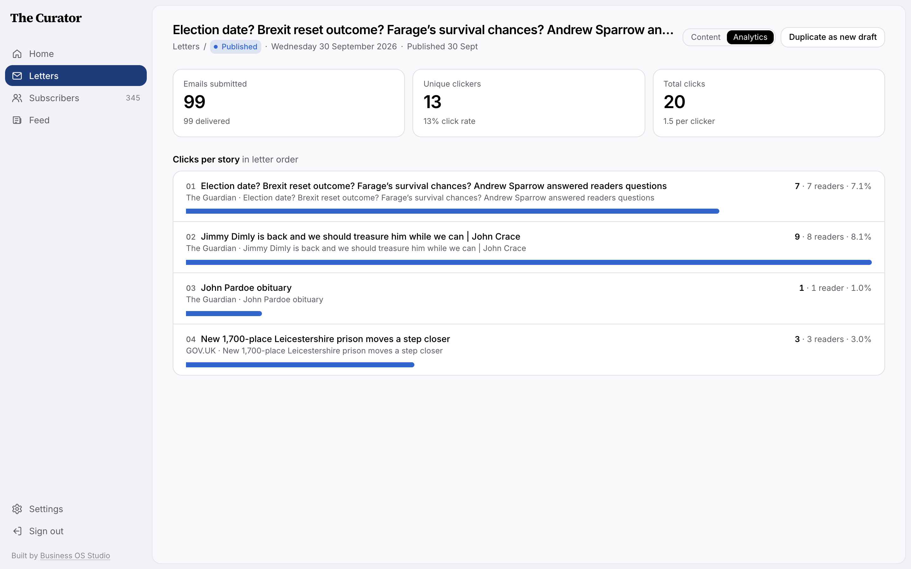

# The Curator

An AI-assisted news and newsletter workspace built as a demo. It collects news, helps draft and edit daily letters, publishes them by email, and tracks engagement.



## Current capabilities

- Store RSS/Atom and Guardian articles in MongoDB; browse and refresh the feed by source.
- Generate a daily letter with Claude, then edit its headline, briefing, story selection and order, or start blank.
- Preview desktop/mobile email layouts, manage draft → ready → published editions, and duplicate past letters.
- Manage browser-associated subscriber lists and publish ready letters through SMTP.
- View subscriber, open and click trends plus per-letter delivery and story-click analytics.
- Configure sources and AI prompts in Settings; optionally show a “Built by …” credit.

The feed displays stored news chronologically. `packages/core` retains a baseline keyword scorer; it is not the feed's AI ranking engine. AI-assisted story selection happens during letter drafting.

## Screenshots

<table>
  <tr>
    <td width="50%"></td>
    <td width="50%"></td>
  </tr>
  <tr>
    <td><b>Letter editor.</b> Edit the headline and briefing, ask AI for suggestions, and see the email exactly as subscribers will.</td>
    <td><b>Letter analytics.</b> Delivery, clickers and clicks per story for each published edition.</td>
  </tr>
  <tr>
    <td colspan="2"></td>
  </tr>
  <tr>
    <td colspan="2"><b>Feed.</b> Stored stories from every source, newest first, filterable by source.</td>
  </tr>
</table>

## Layout

| Path | Purpose |
| --- | --- |
| `apps/web` | Next.js editorial workspace, login, publishing and analytics |
| `apps/worker` | Recurring or one-off source ingestion |
| `packages/db` | MongoDB persistence for articles, sources, letters, subscribers and analytics |
| `packages/ingest` | RSS/Atom and Guardian adapters |
| `packages/ai` | AI drafting, headline suggestions and configurable prompts |
| `packages/newsletter` | HTML/plain-text email rendering and readiness checks |
| `packages/mailer` | SMTP delivery |
| `packages/tracking` | Signed click/open tracking links and reader identifiers |
| `packages/core` | Shared article types and baseline keyword scoring |
| `packages/tsconfig` | Shared TypeScript configuration |

## Getting started

Use Node.js 24 (see `.nvmrc`) and pnpm. Create the environment files first, then fill in MongoDB credentials, `AUTH_PASSWORD` and a generated `AUTH_SECRET` of at least 32 characters before starting the app. AI drafting needs AI Gateway access; Guardian ingestion needs its API key; email delivery needs SMTP configuration.

```sh
pnpm install
cp .env.example .env                         # worker: Mongo + Guardian key
cp apps/web/.env.example apps/web/.env.local # web: auth + Mongo + Guardian key
# Fill in the environment files before continuing.
pnpm build                                   # packages must be built before the apps run
pnpm --filter @curator/worker seed           # add the default sources (or use the Sources page)
pnpm --filter @curator/worker once           # fetch everything that's due, then exit
pnpm --filter @curator/web dev
```

## How it works

Sourcing, letters, subscribers and publishing, dashboard trends, tracking and analytics, and authentication are documented in [implementation.md](implementation.md).

## Scripts (root)

- `pnpm dev` – run every package's dev script in parallel
- `pnpm build` / `pnpm typecheck` / `pnpm test` – run across all packages
- `pnpm lint` / `pnpm format` – Biome

## Configuration notes

- `APP_URL` sets the base URL for click/open tracking links in emails; it falls back to the current request origin.
- `NEWSLETTER_NAME` and `NEWSLETTER_TAGLINE` customize the email branding.
- `ATTRIBUTION_NAME` enables the optional “Built by …” credit on the login page and sidebar. `ATTRIBUTION_URL` optionally links it; an empty name hides it.
- AI prompt overrides are editable at `/settings/prompts` and apply to the next request.
- `.env` files and `.vercel` configuration are ignored by Git; the committed `.env.example` files contain setup placeholders.

## Production roadmap

This is a working private demo, not a production publication service. Source polling, AI-assisted drafting, editorial states, SMTP sending and basic tracking already exist; the steps below are **future work**, not implemented production guarantees. Keep the demo lightweight and address these in order before operating a real publication.

### P0 — Before sending to a real subscriber list

- **Accounts and access:** replace the shared password and browser-owned lists with individual accounts, secure session/recovery flows and admin/editor/publisher roles. Enforce authorization on every server operation and scope data and jobs to a workspace; verify that users cannot read or modify another workspace's subscribers, letters, settings or analytics.
- **Subscriber permission and privacy:** add explicit opt-in with a consent record (source, time and wording), preferably confirmed by email. Include a clear sender identity and working unsubscribe link in every edition, plus provider-required one-click unsubscribe headers. Maintain durable suppression records for opt-outs, hard bounces and complaints; check them immediately before each send, including retries and imports. Publish a privacy notice, define retention/deletion periods for subscriber and tracking data, and retain only the minimum suppression data needed to honour opt-outs. Review UK GDPR and PECR obligations, including tracking, processors and international transfers; do not assume an imported address or a new contact qualifies for a soft opt-in. Use the [ICO's electronic mail marketing guidance](https://ico.org.uk/for-organisations/direct-marketing-and-privacy-and-electronic-communications/guidance-on-direct-marketing-using-electronic-mail/) to confirm the publication's requirements before launch.
- **Bulk delivery:** select a managed bulk-email provider that supports the intended newsletter volume, delivery events and suppression handling. Configure SPF, DKIM and DMARC alignment for the sending domain, establish sending reputation gradually, and monitor bounce/complaint rates. Replace the request-bound, 200-recipient demo send with queued batches, provider-aware throttling and bounded retries with backoff. Verify and deduplicate provider webhooks; process bounces and complaints promptly. Record per-recipient delivery state and reconcile uncertain submissions before retrying so a timeout does not send the same edition twice.
- **Deployment and launch QA:** document separate web, worker/queue and database deployment, environment variables/secrets, DNS, webhook endpoints, migrations/indexes and backup/restore steps. Separate staging from production and restrict staging to test recipients. Run build, type checks and database integration tests; exercise account/workspace boundaries, consent and unsubscribe, email rendering/links, partial sends, duplicate jobs/webhooks, provider outages and restore/rollback. Start with a small opted-in pilot and a tested send-pause control.

### P1 — Reliable autonomous preparation, with editorial control

- **Scheduled editions:** build on the existing polling worker to schedule sourcing → curation → letter drafting in the publication's timezone, including daylight-saving changes. Use durable jobs, locks and idempotency keys per workspace/edition/stage so restarts or overlapping schedules do not create duplicate drafts or sends. Flag missing/stale sources and failed AI runs for review. Require a human to review sources, factual accuracy and copy, then explicitly approve the exact edition revision before sending; subsequent edits invalidate approval. Automatic preparation must not bypass that gate.
- **Operations and recovery:** run ingestion, AI and delivery through persistent queues with bounded concurrency, timeouts, retry limits and a failed-job queue with controlled replay. Alert on missed editions, stale feeds, growing queues and delivery failures. Keep an audit history of draft revisions, approvals, sends and job attempts; make partial-run recovery visible to an operator. Store and rotate secrets outside source control, redact sensitive logs, and enforce source, AI and email rate limits and spend limits. Assign an operator and document pause, recovery and incident procedures.

### P2 — Trustworthy reporting before optimising growth

- **Analytics quality:** distinguish queued, provider-accepted, delivered, bounced and complained events; provider acceptance is not inbox placement. Deduplicate events and define per-edition denominators and reporting windows. Flag/filter likely mail privacy proxy opens and automated link-scanner clicks, retain raw versus filtered counts only within the retention policy, and label remaining uncertainty. Validate against provider reports and controlled test messages; do not treat opens or scanner-inflated clicks as verified human engagement.

## License

[MIT](LICENSE) — Copyright (c) 2026 Kervens Volcy.
