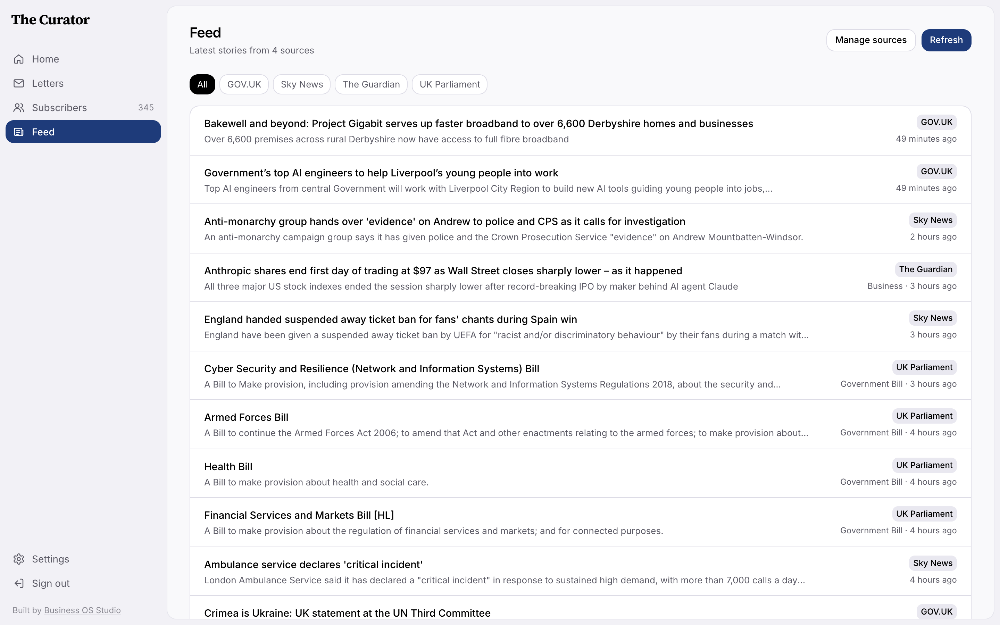

# The Curator

An AI-assisted news and newsletter workspace built as a demo by Business OS Studio. It collects news, helps draft and edit daily letters, publishes them by email, and tracks engagement.

**Demo:** [ai-news-curator-rust.vercel.app](https://ai-news-curator-rust.vercel.app). The deployed app uses a shared-password login and is intended only for private evaluation, not public use or a public multi-user service. The source code is MIT-licensed.


## Current capabilities

- Store RSS/Atom and Guardian articles in MongoDB; browse and refresh the feed by source.
- Generate a daily letter with Claude, then edit its headline, briefing, story selection and order, or start blank.
- Preview desktop/mobile email layouts, manage draft → ready → published editions, and duplicate past letters.
- Manage browser-associated subscriber lists and publish ready letters through SMTP.
- View subscriber, open and click trends plus per-letter delivery and story-click analytics.
- Configure sources and AI prompts in Settings; optionally show a “Built by Business OS Studio” credit.

The feed displays stored news chronologically. `packages/core` retains a baseline keyword scorer; it is not the feed's AI ranking engine. AI-assisted story selection happens during letter drafting.

## Screenshots

<table>
  <tr>
    <td width="50%"></td>
    <td width="50%"></td>
  </tr>
  <tr>
    <td><b>Letter editor.</b> Edit the headline and briefing, ask AI for suggestions, and see the email exactly as subscribers will.</td>
    <td><b>Letter analytics.</b> Delivery, clickers and clicks per story for each published edition.</td>
  </tr>
  <tr>
    <td colspan="2"></td>
  </tr>
  <tr>
    <td colspan="2"><b>Feed.</b> Stored stories from every source, newest first, filterable by source.</td>
  </tr>
</table>

## Layout

| Path | Purpose |
| --- | --- |
| `apps/web` | Next.js editorial workspace, login, publishing and analytics |
| `apps/worker` | Recurring or one-off source ingestion |
| `packages/db` | MongoDB persistence for articles, sources, letters, subscribers and analytics |
| `packages/ingest` | RSS/Atom and Guardian adapters |
| `packages/ai` | AI drafting, headline suggestions and configurable prompts |
| `packages/newsletter` | HTML/plain-text email rendering and readiness checks |
| `packages/mailer` | SMTP delivery |
| `packages/tracking` | Signed click/open tracking links and reader identifiers |
| `packages/core` | Shared article types and baseline keyword scoring |
| `packages/tsconfig` | Shared TypeScript configuration |

## Getting started

Use Node.js 24 (see `.nvmrc`) and pnpm. Create the environment files first, then fill in MongoDB credentials, `AUTH_PASSWORD` and a generated `AUTH_SECRET` of at least 32 characters before starting the app. AI drafting needs AI Gateway access; Guardian ingestion needs its API key; email delivery needs SMTP configuration.

```sh
pnpm install
cp .env.example .env                         # worker: Mongo + Guardian key
cp apps/web/.env.example apps/web/.env.local # web: auth + Mongo + Guardian key
# Fill in the environment files before continuing.
pnpm build                                   # packages must be built before the apps run
pnpm --filter @curator/worker seed           # add the default sources (or use the Sources page)
pnpm --filter @curator/worker once           # fetch everything that's due, then exit
pnpm --filter @curator/web dev
```

## Sourcing

Sources live in the `sources` collection and are managed at `/settings/sources` in the web app (add, edit, pause, delete, fetch now).
Two kinds are supported:

- `feed`: any RSS 2.0 or Atom URL.
- `guardian`: the Guardian Content API, filtered by section (for example, politics or UK news) and/or a search query. Needs `GUARDIAN_API_KEY`.

Default sources (`pnpm --filter @curator/worker seed`, or "Add default sources" on an empty Sources page):

| Source        | Kind     | Endpoint                                                 |
| ------------- | -------- | -------------------------------------------------------- |
| Sky News      | feed     | `https://feeds.skynews.com/feeds/rss/uk.xml`             |
| The Guardian  | guardian | sections: politics, uk-news, business, society |
| GOV.UK        | feed     | `https://www.gov.uk/search/news-and-communications.atom` |
| UK Parliament | feed     | `https://bills.parliament.uk/rss/allbills.rss`           |

parliament.uk's news and committee feeds sit behind a Cloudflare bot challenge, so the Bills feed is used instead.

Articles are stored in `articles`, unique per source + external id (RSS guid, Atom id or Guardian id), so re-fetching updates existing stories instead of duplicating them.

The worker (`pnpm --filter @curator/worker start`) checks every minute and fetches each enabled source once its interval has elapsed. The worker must run separately from the web app for automatic polling; the web app also supports manual refresh. Each fetch records `lastFetchedAt`, `lastStatus`, `lastError` and counts on the source; the Sources page shows them.

### Tests against MongoDB

```sh
docker run -d --rm --name curator-mongo-test -p 27399:27017 mongo:8
MONGO_TEST_URL=mongodb://localhost:27399 pnpm test
```

Without `MONGO_TEST_URL` the database integration tests are skipped.

## Letters

A letter is one edition of the daily email: headline, publication date, a 60–100 word daily briefing, and an ordered list of stories. Manage them at `/letters`; each opens in the editor at `/letters/:id`.

- **Stories** are picked from the stored articles (or added manually as external links). Each story keeps a reference to its article _and_ a snapshot of the original headline, URL and publisher, plus its own rewritten headline and description. Editing a story in one letter never touches the article or any other letter.
- **Lifecycle:** draft → ready → published. "Ready" requires a headline, a briefing, at least one story and a headline on every story. Editing a ready letter so it no longer qualifies moves it back to draft. Published letters are locked and store the exact HTML rendered at publication (`publishedHtml`), so past editions are reproducible. Duplicate a letter to start a new edition from it. Only drafts can be deleted.
- **Concurrent edits:** every save carries the letter's `revision`; a stale save is rejected instead of overwriting someone else's changes.
- **Preview:** the editor renders the same HTML (`@curator/newsletter`) that delivery will send, live, at desktop or mobile width.
- **New letter walkthrough:** **New letter** opens a dialog that drafts a whole edition. Pick the date (today by default) and optionally a tone; it refreshes each source (for today or yesterday; each shows its result as it comes back), gathers that London day's stories, and Claude picks the 3 to 5 most important distinct ones and writes a headline and summary for each, then the edition headline and briefing. The draft streams in (`POST /api/letters/draft`, newline-delimited JSON), so you watch the day's headlines being read and then the letter being written; cancelling stops the model call. The letter is then created as a draft and opened in the editor, every story linked to its source article, ready to edit. **Start blank instead** creates an empty letter.
- **AI assistance** (`@curator/ai`, Claude Opus 5.5 via the [Vercel AI SDK](https://ai-sdk.dev) and **AI Gateway**): the walkthrough above, plus suggesting letter headlines, writing or revising the briefing, and rewriting story headlines in the editor, in an editorial tone you choose. Prompts are grounded in the supplied stories only, and the editor reviews everything. Needs `AI_GATEWAY_API_KEY` in `apps/web/.env.local` (on Vercel, OIDC works without a key). If Opus fails, the gateway falls back to Claude Sonnet 5.5.

## Subscribers and publishing (demo)

Subscribers are managed by the editors only: there's no public signup page and no unsubscribe link. They're stored in MongoDB (`subscribers` collection), one row per address, deduped by lowercased email. There are no user accounts (one shared password), so lists are **per browser**: each browser gets an opaque random id in a long-lived `curator_owner` cookie (issued by the proxy, kept across sign-out), and each subscriber row lists the browsers that reference it (`ownerIds`).

- Everyone sees the **total** number of subscribers (in the side nav and on `/subscribers`), but only the details of addresses on their own list.
- `/subscribers` (signed in): add one or paste a list, search, remove, clear (your list only). Adding an address that already exists doesn't duplicate it: it's linked to your list. Removing an address is how you unsubscribe it: it drops your reference only, and the row is deleted once no list references it.
- A list left in this browser's `localStorage` by an older version is moved to the database the first time the page opens (addresses that had unsubscribed are left out). On startup, rows from older versions are migrated, and any that a reader had unsubscribed are deleted.
- In the letter editor, **Publish** confirms sending a ready letter to this browser's subscriber list (up to 200 addresses). With recipients, at least one successful SMTP submission is required to publish; with no recipients, it publishes and archives the HTML without sending email.
- Published letters are locked. Duplicate one to create a new editable edition. The current editor has no separate test-send or resend dialog.
- Each email has tracked story links, an open pixel and a plain-text part. The footer explains that the editor added the recipient. Send history records counts; “delivered” means accepted by SMTP, not confirmed inbox delivery.
- Delivery needs `SMTP_URL` and `SMTP_FROM` in `apps/web/.env.local`. Any SMTP provider works. For local testing, use [Mailpit](https://mailpit.axllent.org/):

  ```sh
  docker run -d --rm -p 1025:1025 -p 8025:8025 axllent/mailpit
  # SMTP_URL=smtp://localhost:1025, inbox at http://localhost:8025
  ```

## Dashboard trends

The Overview page charts **subscribers**, **open rate** and **click rate** over 7, 30 or 90 days. Every related action increments counters on one document per day (UTC) in `daily_stats`, so the dashboard reads those documents directly with no aggregation:

- **Subscribers:** creating or deleting an address updates a running total (`counters`) and snapshots it on the day. Linking an existing address doesn't change it.
- **Delivered:** emails delivered by subscriber sends.
- **Opens:** each email carries a 1×1 image loading `/o/<token>.gif`. **Clicks:** the existing `/r/<token>` route. Both count every hit plus a *unique* count, once per reader per letter (`letter_readers`).
- Rates are unique opens (or clicks) ÷ delivered over a **trailing 7 days**, since opens and clicks land days after a send. Opens are approximate: some mail apps block images, others (Apple Mail Privacy Protection) load them without the reader opening the email.
- Test sends never count. The running total is seeded from the existing subscribers on first start.

## Tracking and analytics

Each sent letter has its own analytics page, `/letters/:letterId/analytics` (linked from the letter editor), showing for subscriber sends (test sends are tracked but excluded):

- **Emails submitted** (and delivered/failed), from the letter's send history.
- **Unique recipients who clicked**, with the click rate (unique clickers ÷ delivered).
- **Total clicks per article**, every story in letter order.

How it works, without storing addresses in analytics:

- Every reader gets a **pseudonymous id**: an HMAC of their address keyed by `TRACKING_SECRET` (default: `AUTH_SECRET`). It's stable across letters, so readers can be counted, but can't be reversed without the secret.
- At send time each story link becomes `/r/<token>`, a signed token with the letter, story, reader id and test flag. `/r/…` records the click (in `email_events`) and redirects to the story URL **stored in the letter**, so it can't be used as an open redirect, and tampered tokens are rejected.
- Mail providers that pre-scan links can add clicks; there's no bot filtering yet.

## Authentication

The demo is protected by one shared password, with no individual user accounts. Sources, letters and settings are shared; browser-associated subscriber lists are a demo convenience, not separate user workspaces.

- `AUTH_PASSWORD`: the password everyone signs in with.
- `AUTH_SECRET`: at least 32 characters, used to sign session cookies (`openssl rand -base64 32`).
- `AUTH_PASSWORD_HINT` (optional): shown under the password field on the login page. Anyone who can reach the login page can read it, so don't make it guessable.

A successful login sets a signed, HTTP-only cookie that lasts 7 days. Changing either variable signs everyone out.
`proxy.ts` redirects unauthenticated requests to `/login`, but every protected page and server action must still call `requireSession()` from `lib/auth/session.ts`.
In production the cookie is marked `Secure`, so the app must be served over HTTPS (localhost is exempt).

## Scripts (root)

- `pnpm dev` – run every package's dev script in parallel
- `pnpm build` / `pnpm typecheck` / `pnpm test` – run across all packages
- `pnpm lint` / `pnpm format` – Biome

## Configuration notes

- `APP_URL` sets the base URL for click/open tracking links in emails; it falls back to the current request origin.
- `NEWSLETTER_NAME` and `NEWSLETTER_TAGLINE` customize the email branding.
- `ATTRIBUTION_NAME=Business OS Studio` enables the existing “Built by …” credit on the login page and sidebar. `ATTRIBUTION_URL` optionally links it; an empty name hides it.
- AI prompt overrides are editable at `/settings/prompts` and apply to the next request.
- `.env` files and `.vercel` configuration are ignored by Git; the committed `.env.example` files contain setup placeholders.

## Production roadmap

This is a working private demo, not a production publication service. Source polling, AI-assisted drafting, editorial states, SMTP sending and basic tracking already exist; the steps below are **future work**, not implemented production guarantees. Keep the demo lightweight and address these in order before operating a real publication.

### P0 — Before sending to a real subscriber list

- **Accounts and access:** replace the shared password and browser-owned lists with individual accounts, secure session/recovery flows and admin/editor/publisher roles. Enforce authorization on every server operation and scope data and jobs to a workspace; verify that users cannot read or modify another workspace's subscribers, letters, settings or analytics.
- **Subscriber permission and privacy:** add explicit opt-in with a consent record (source, time and wording), preferably confirmed by email. Include a clear sender identity and working unsubscribe link in every edition, plus provider-required one-click unsubscribe headers. Maintain durable suppression records for opt-outs, hard bounces and complaints; check them immediately before each send, including retries and imports. Publish a privacy notice, define retention/deletion periods for subscriber and tracking data, and retain only the minimum suppression data needed to honour opt-outs. Review UK GDPR and PECR obligations, including tracking, processors and international transfers; do not assume an imported address or a new contact qualifies for a soft opt-in. Use the [ICO's electronic mail marketing guidance](https://ico.org.uk/for-organisations/direct-marketing-and-privacy-and-electronic-communications/guidance-on-direct-marketing-using-electronic-mail/) to confirm the publication's requirements before launch.
- **Bulk delivery:** select a managed bulk-email provider that supports the intended newsletter volume, delivery events and suppression handling. Configure SPF, DKIM and DMARC alignment for the sending domain, establish sending reputation gradually, and monitor bounce/complaint rates. Replace the request-bound, 200-recipient demo send with queued batches, provider-aware throttling and bounded retries with backoff. Verify and deduplicate provider webhooks; process bounces and complaints promptly. Record per-recipient delivery state and reconcile uncertain submissions before retrying so a timeout does not send the same edition twice.
- **Deployment and launch QA:** document separate web, worker/queue and database deployment, environment variables/secrets, DNS, webhook endpoints, migrations/indexes and backup/restore steps. Separate staging from production and restrict staging to test recipients. Run build, type checks and database integration tests; exercise account/workspace boundaries, consent and unsubscribe, email rendering/links, partial sends, duplicate jobs/webhooks, provider outages and restore/rollback. Start with a small opted-in pilot and a tested send-pause control.

### P1 — Reliable autonomous preparation, with editorial control

- **Scheduled editions:** build on the existing polling worker to schedule sourcing → curation → letter drafting in the publication's timezone, including daylight-saving changes. Use durable jobs, locks and idempotency keys per workspace/edition/stage so restarts or overlapping schedules do not create duplicate drafts or sends. Flag missing/stale sources and failed AI runs for review. Require a human to review sources, factual accuracy and copy, then explicitly approve the exact edition revision before sending; subsequent edits invalidate approval. Automatic preparation must not bypass that gate.
- **Operations and recovery:** run ingestion, AI and delivery through persistent queues with bounded concurrency, timeouts, retry limits and a failed-job queue with controlled replay. Alert on missed editions, stale feeds, growing queues and delivery failures. Keep an audit history of draft revisions, approvals, sends and job attempts; make partial-run recovery visible to an operator. Store and rotate secrets outside source control, redact sensitive logs, and enforce source, AI and email rate limits and spend limits. Assign an operator and document pause, recovery and incident procedures.

### P2 — Trustworthy reporting before optimising growth

- **Analytics quality:** distinguish queued, provider-accepted, delivered, bounced and complained events; provider acceptance is not inbox placement. Deduplicate events and define per-edition denominators and reporting windows. Flag/filter likely mail privacy proxy opens and automated link-scanner clicks, retain raw versus filtered counts only within the retention policy, and label remaining uncertainty. Validate against provider reports and controlled test messages; do not treat opens or scanner-inflated clicks as verified human engagement.

## License

[MIT](LICENSE) — Copyright (c) 2026 Kervens Volcy.
